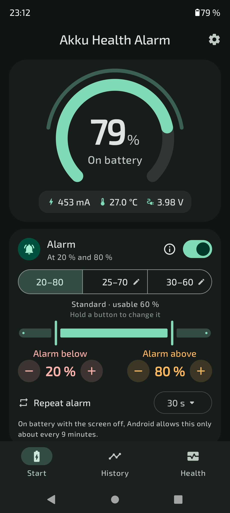
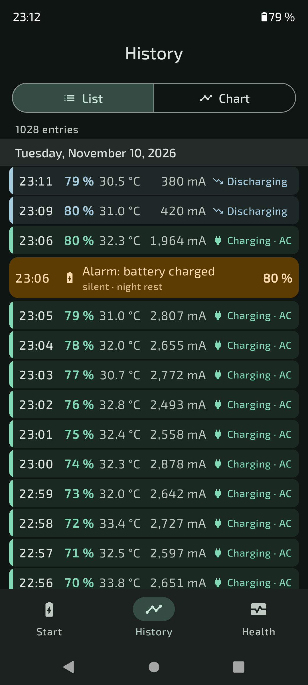
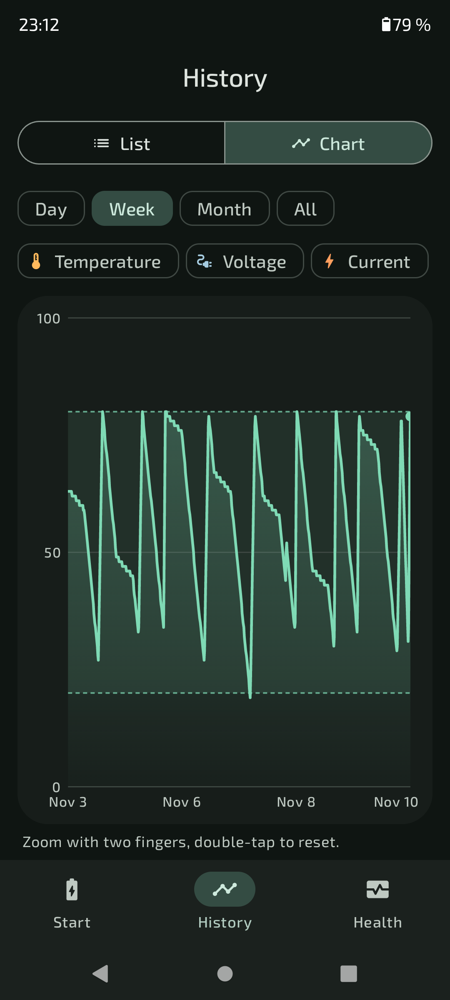
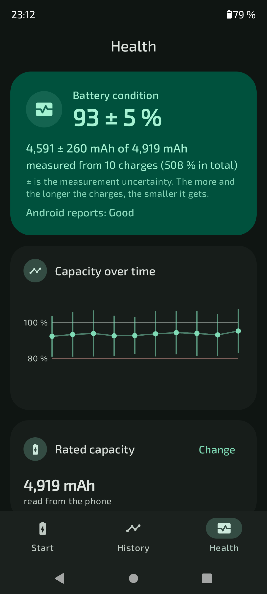

# Akku Health Alarm

Android app that helps your battery live longer: it reminds you to unplug the charger at 80 %
and to plug it in at 20 % (or at your own limits), keeps a history of every charge and measures
the real battery capacity. Fully offline – the app has no internet permission.

<p>




</p>

## Features

**Alarm**
- Limits 20–80 % by default; quick choices 25–70 and 30–60, two of them can be changed (hold the button)
- Exact input with − / + or the keypad; a recommendation is shown, no fixed bounds
- Repeat until you react (10 s … 12 h), with a countdown in the app and in the notification
- App sound or phone sound, short spoken announcement (app voice or the phone's offline voice), vibration
- Night rest, "also when muted", the alarm notification can be switched off
- Optional temperature alarm: too hot, or too cold (by default only while charging)

**History**
- Log with one line per real change: level, temperature, current, charger type (USB / AC / wireless), alarms
- Chart for day, week, month or everything, zoomable, with temperature, voltage or charge/discharge current

**Battery health**
- Capacity estimated from your own charges (at least 15 % each), weighted over the last 10, with ± uncertainty
- Phones whose "charge counter" is only percentage × rated capacity are detected; the app then measures the current itself
- Charging speed per charger, equivalent charge cycles, recent charges

**Reliability and privacy**
- The watcher runs in its own small process (about 15 MB) as a foreground service
- Help for the battery savers of Huawei, Xiaomi, Samsung, Oppo, Vivo, OnePlus
- No internet permission, no ads, no tracking, no analytics

20 languages (en, de, fr, es, it, nl, pt-BR, pl, cs, sk, hu, ro, sv, da, nb, fi, el, tr, ru, uk);
the language can be chosen in the app. Android 7.0 (API 24) and newer.

## Building

Requirements: JDK 21 and the Android SDK.

```bash
./gradlew assembleDebug testDebugUnitTest
```

The APK is in `app/build/outputs/apk/debug/`.

### Translations

The texts live in `app/src/main/res/values*/strings.xml`. After changing them directly, run
`python3 tools/i18n/export.py`; it writes `tools/i18n/source.json` and `tools/i18n/<lang>.txt`,
from which `python3 tools/i18n/build.py <langs>` rebuilds the XML files (with checks for placeholders).

## License

GPL-3.0-or-later, see [LICENSE](LICENSE).
