# Akku Health Alarm

Android app that helps your battery live longer: it tells you when to unplug the charger and when
to plug it in – at limits you set yourself, or with one tap on a gentle preset (25–70 %, 30–60 %).
It keeps a history of every charge and measures the real battery capacity.

**[⬇ Download the APK (latest release)](https://github.com/Patrick-Ric/akku-health-alarm/releases/latest)** – Android 7.0 and newer

## No anti-features

F-Droid warns about "anti-features" – things in an app that work against its users. This app has none
of them, and each one it does not have is a plus:

- **No ads** – no advertising of any kind.
- **No tracking** – no analytics, no crash reports, nothing about you or your phone is collected.
- **No internet** – the app does not even have the internet permission, so it cannot send anything.
  All data stays on your phone.
- **No non-free parts** – only free libraries (AndroidX, Kotlin, Okio), no Google Play Services;
  it also works on phones without Google.
- **No non-free media** – the sounds and voice clips were made for this app and are part of the free source.
- **No account, no sign-in, no in-app purchases.**
- **Open and checkable** – free software under GPL-3.0, and the release APK is a reproducible build:
  it can be rebuilt from the source bit by bit.

<p>
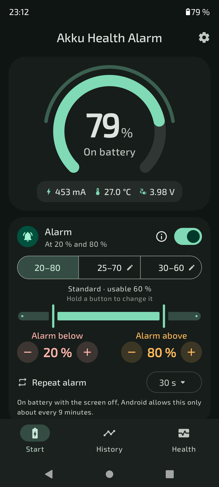
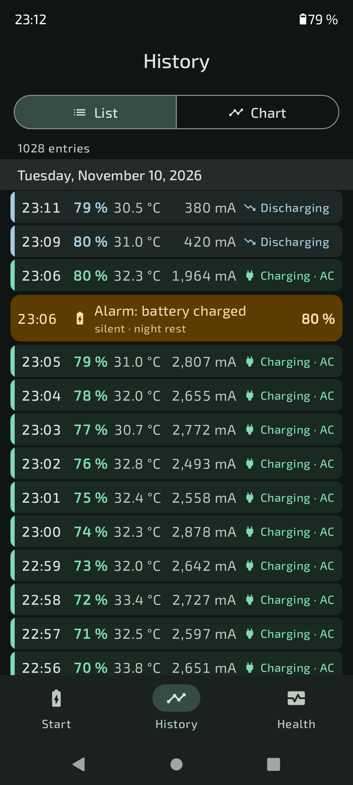
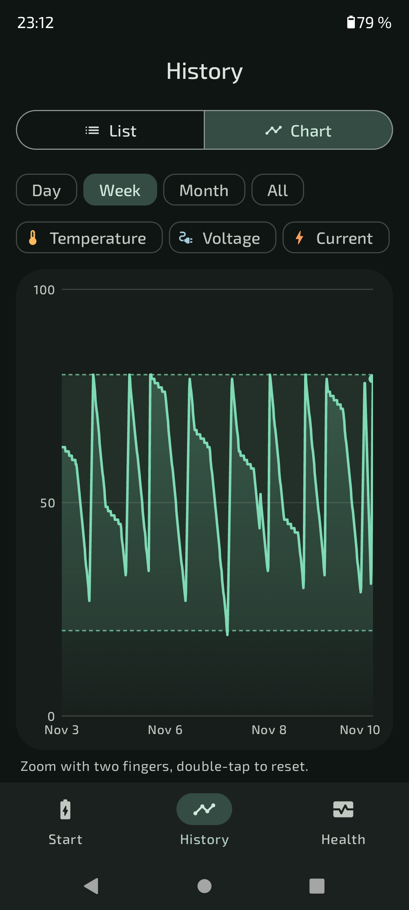
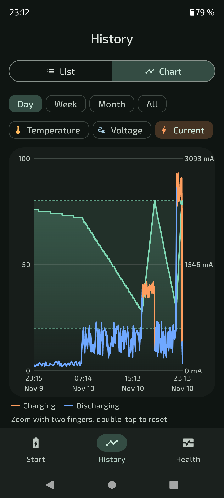
</p>
<p>
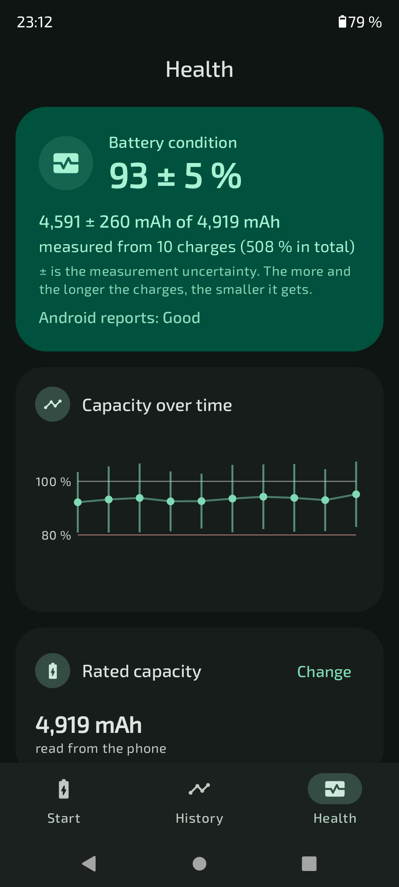
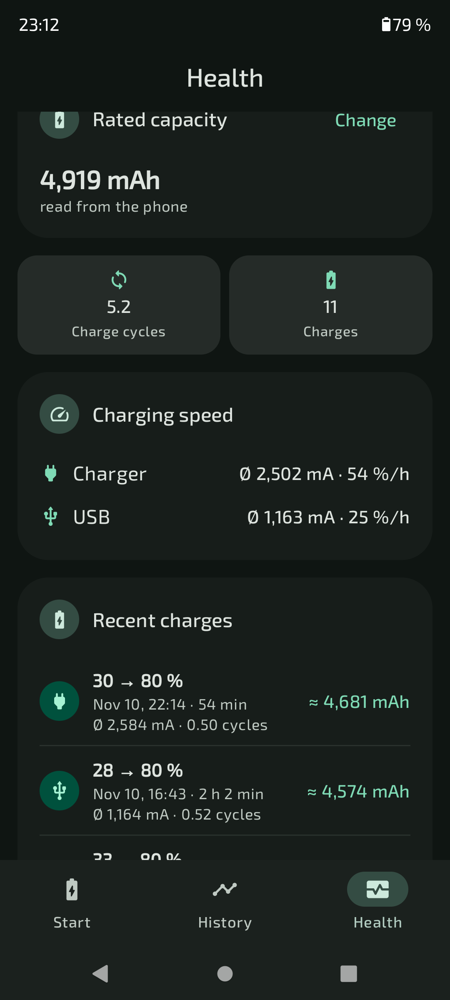
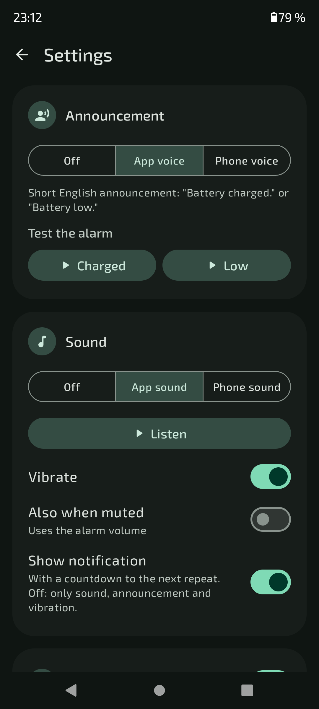
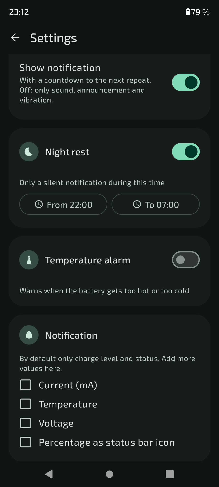
</p>
<p>
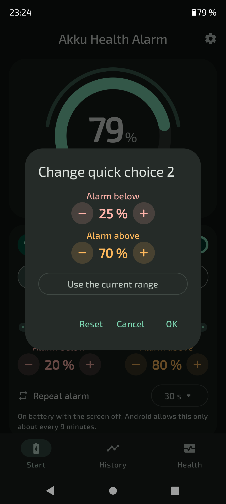
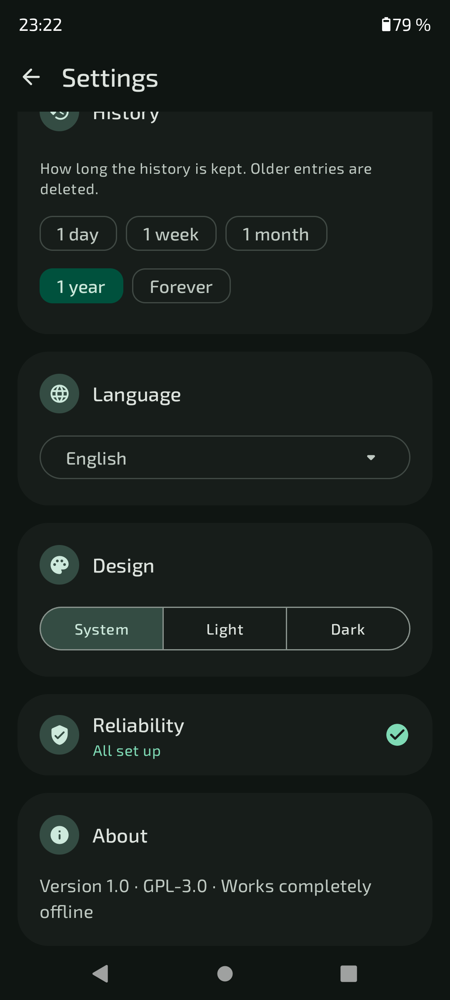
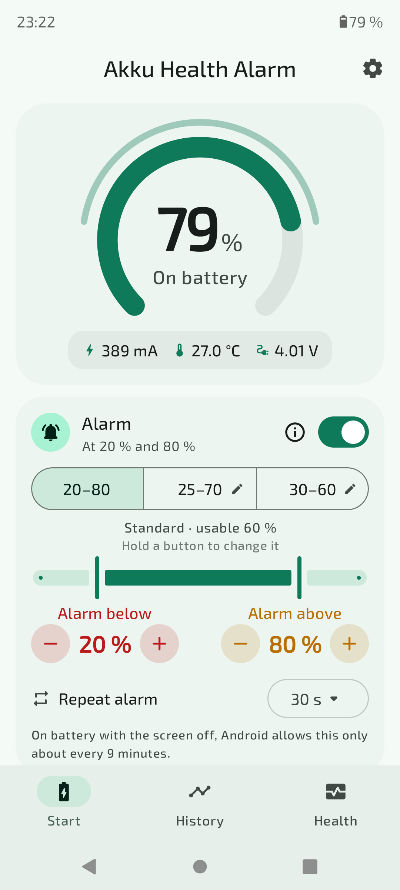
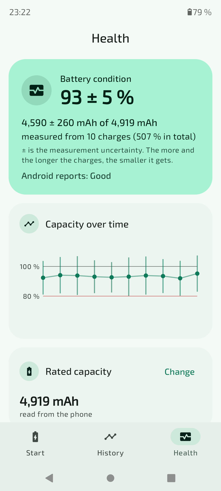
</p>

## Features

**Alarm**
- Free limits from 1 to 100 %, with − / + or the keypad (a recommendation is shown, no fixed bounds)
- Quick choices 20–80 %, 25–70 % (gentle) and 30–60 % (very gentle); the two gentle ones can be changed (hold the button)
- Repeat until you react (10 s … 12 h), with a countdown in the app and in the notification
- App sound or phone sound, short spoken announcement (app voice or the phone's offline voice), vibration
- Night rest, "also when muted", the alarm notification can be switched off
- Optional temperature alarm: too hot, or too cold (by default only while charging)

**History**
- Log with one line per real change: level, temperature, current, charger type (USB / AC / wireless), alarms
- Chart for day, week, month or everything, zoomable, with temperature, voltage or charge/discharge current

**Battery health**
- Capacity estimated from your own charges (at least 15 % each), weighted over the last 10, with ± uncertainty
- Phones whose "charge counter" is only percentage × rated capacity are detected; the app then measures the current itself
- Charging speed per charger, equivalent charge cycles, recent charges

**Reliability**
- The watcher runs as a foreground service in its own small process; the user interface can be closed
- Help for the battery savers of Huawei, Xiaomi, Samsung, Oppo, Vivo, OnePlus

20 languages (en, de, fr, es, it, nl, pt-BR, pl, cs, sk, hu, ro, sv, da, nb, fi, el, tr, ru, uk);
the language can be chosen in the app. Android 7.0 (API 24) and newer.

## Building

Requirements: JDK 21 and the Android SDK.

```bash
./gradlew assembleDebug testDebugUnitTest
```

The APK is in `app/build/outputs/apk/debug/`.

### Translations

The texts live in `app/src/main/res/values*/strings.xml`. After changing them directly, run
`python3 tools/i18n/export.py`; it writes `tools/i18n/source.json` and `tools/i18n/<lang>.txt`,
from which `python3 tools/i18n/build.py <langs>` rebuilds the XML files (with checks for placeholders).

## License

GPL-3.0-or-later, see [LICENSE](LICENSE).
